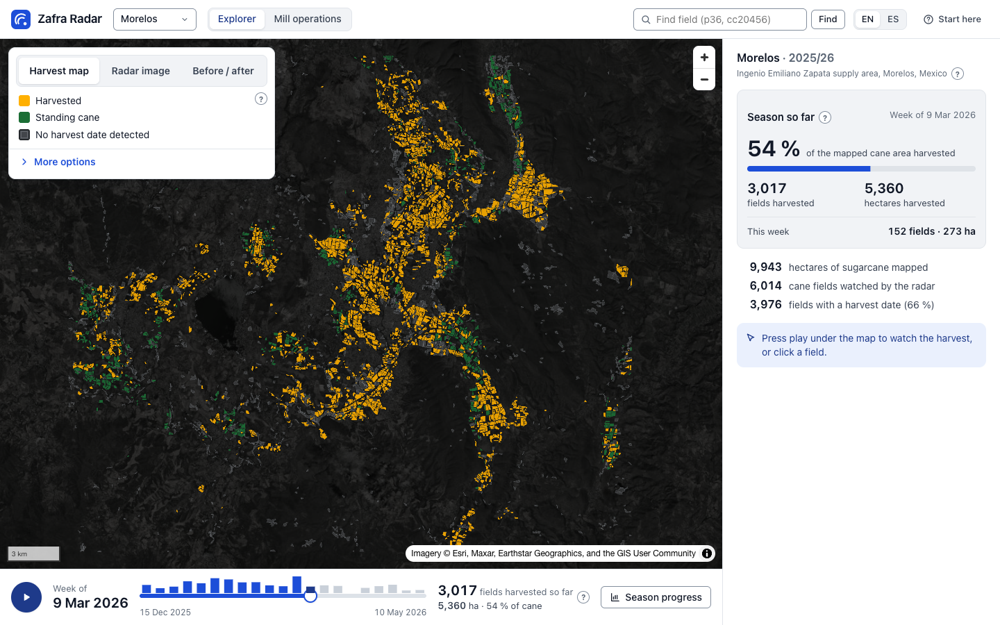
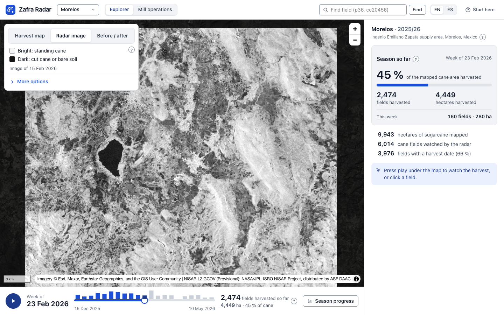
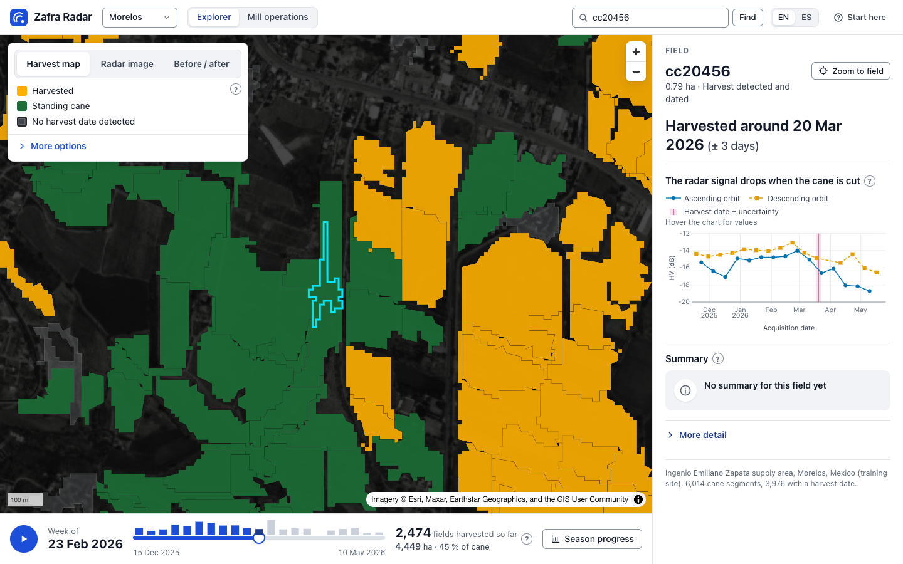
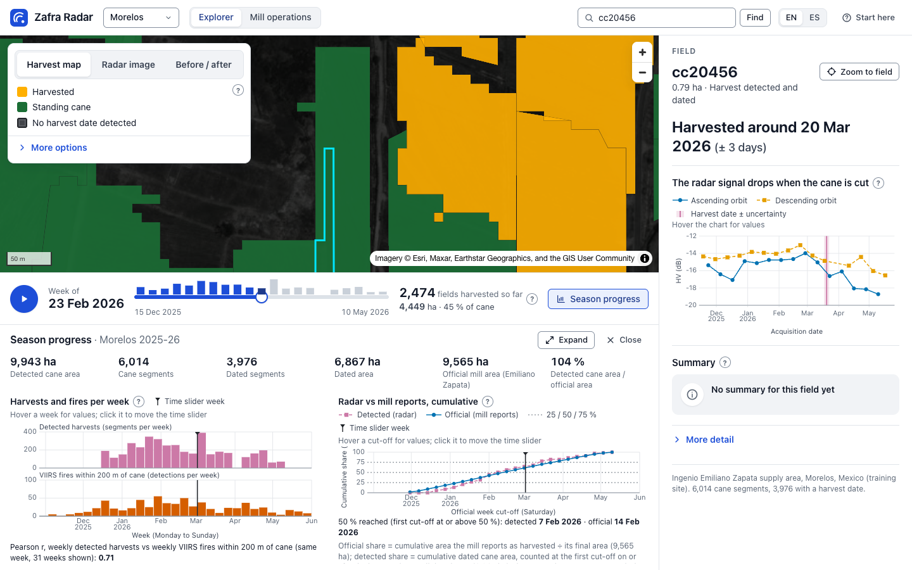
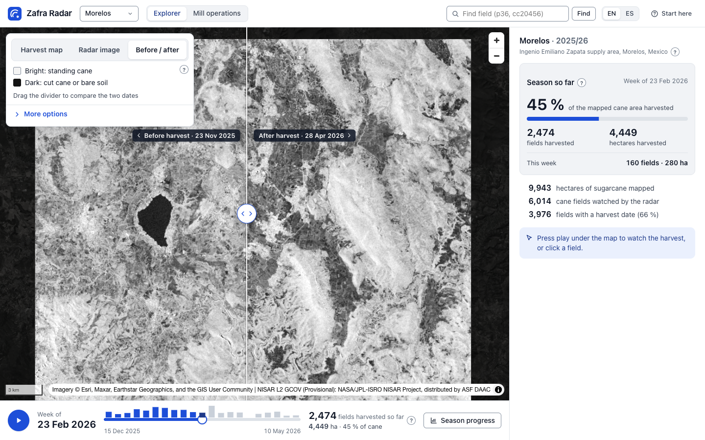
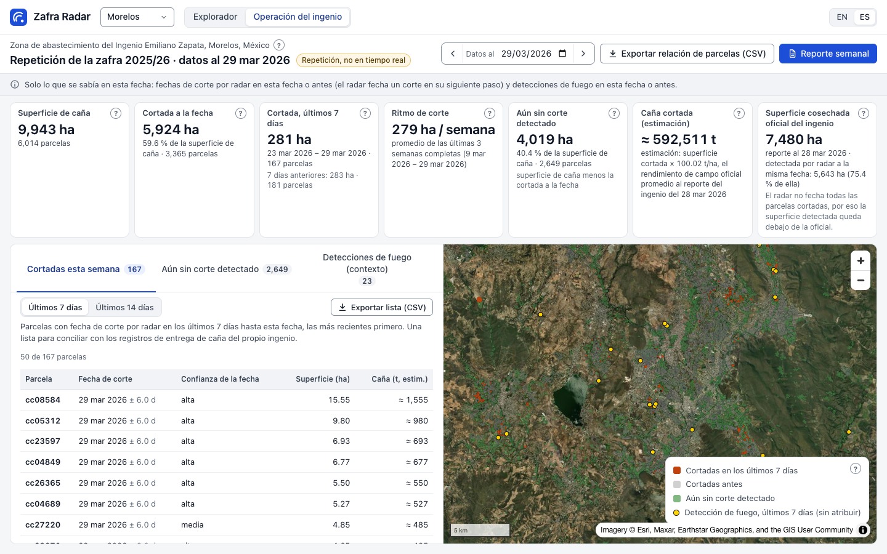
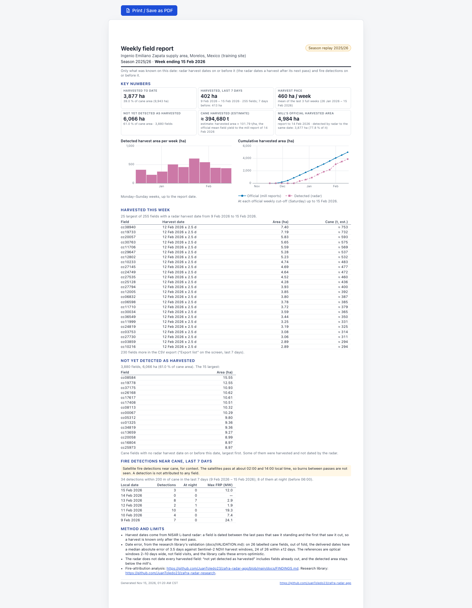

Zafra Radar — application built during NASA Space Apps 2026 (Nov 14–15, Zacatepec). Built on top of zafra-radar-research (https://github.com/JuanToledo23/zafra-radar-research), an open-source toolkit published before the event; see AI_USAGE.md.

# Zafra Radar

Map of the sugarcane harvest (*zafra*) from NISAR L-band radar, for Morelos (Mexico) and
a transfer site in Ribeirão Preto (Brazil). PostGIS 16 + FastAPI + React/MapLibre, started
with one command.

## What existed before the event and what was built during it

| Before the event (in zafra-radar-research, MIT, cited as a resource) | During the event (this repo) |
|---|---|
| NISAR readers (GCOV backscatter, GUNW coherence) | Loader from the library's result files into PostGIS |
| Cane / non-cane gate | API (sites, segment tiles, segment detail, weekly, alerts) |
| Harvest-date detector | Map |
| Validation | Field detail |
| Precomputed result files (harvest maps, weekly counts, series, summaries, raster tiles) | Season dashboard |
| Empty product skeleton (compose, empty schema, `/health`, `/version`, sample map), copied into this repo from `v0.1.0` | Alerts |
| | Raster swipe |
| | Site switcher |
| | Deployment |

Disclosure: the library received one commit during the event, 0d6b064 (2026-11-14), which
adds the comparison of detected harvest with official CONADESUCA mill reports. It is
analysis only and does not touch the skeleton. Everything else in the library is in v0.1.0.

The initial scaffold (empty compose/API/map skeleton) was copied from the product/ directory
of zafra-radar-research v0.1.0 (commit 40edf63, tagged 2026-11-11, before the event). The
copy was taken from the library checkout at commit 0d6b064, where product/ is byte-identical
to v0.1.0.

This repo's git history is the record of the work done during the event;
[docs/JOURNAL.md](docs/JOURNAL.md) is the build log.

## Status

What exists right now:

* `docker compose up` starts PostGIS, the API and the web app;
* the database schema (`api/app/schema.sql`) is created on API start;
* the **loader** (`docker compose exec api python -m app.loader --site morelos|brazil|all`)
  fills the schema from the library's result files for both sites (see [DATA.md](DATA.md));
* the **API** serves the loaded data: `/sites`, `/tiles/{site}/{z}/{x}/{y}.pbf` (segment
  vector tiles), `/segments/{site}/{segment_id}`, `/weekly/{site}`, `/reference/{site}`,
  `/alerts/{site}` and `/rasters/{site}` (the library's NISAR image tiles, read from disk),
  besides `/health` and `/version` (see [docs/API.md](docs/API.md));
* the **map** draws the segment vector tiles from the API, with a site select (Morelos /
  Brazil) that refits the map, a weekly time slider with play/pause over the site's harvest
  dates ("Week of" its Monday) and the fields harvested so far (`/weekly`) with their hectares
  (`/ops/{site}/series`), and three views, one click each: **Harvest map** (harvested amber,
  standing green, no harvest date subdued, over a dark basemap; while the timeline advances the
  week's harvests light up and fade into amber; colour by harvest date under More options),
  **Radar image** (the NISAR HV image following the timeline) and **Before / after** (first
  against last acquisition with a draggable divider, labelled on each side); a legend of at
  most three entries. The map opens on the extent of the site's cane fields; on a first visit
  the season plays once by itself (not with reduced motion, not with `?present=1`); the
  slider draws the season's weekly harvests along its track, and the timeline gives the share
  of the mapped cane harvested;
* the **field detail panel**: clicking a segment loads `/segments/{site}/{segment_id}` into
  the side panel: area, status and "Zoom to field"; one sentence, "Harvested around <date>
  (± n days)" or "No harvest date detected"; the HV radar signal of both orbits with the
  harvest date band; the field summary with an EN / ES toggle and its source. "More detail"
  holds the date confidence, the optical and radar cane probabilities, HV drop and minimum
  coherence, HV, HH and coherence charts on one date axis with nearby fires, the fire list
  within 200 m and the field's alerts; with nothing selected the panel shows "Season so far"
  (share of the mapped cane area harvested, fields and hectares so far, this week's harvest),
  following the timeline, and the site's three key numbers;
* the **season progress panel** ("Season progress" on the timeline bar under the map) opens as a
  drawer across the bottom of the map, from `/sites` and `/weekly/{site}`: cane and dated area and segment counts (and,
  for Morelos, the official mill area and detected area as a share of it); weekly detected
  harvests and VIIRS fires within 200 m of cane on one axis with their Pearson r computed in
  the browser (replaced by a note when the season has fewer than 30 fires in cane); for Morelos, detected vs official cumulative share with the 25/50/75 % levels
  and the 50 % crossing dates. A marker follows the time slider on every chart, and clicking
  a week moves the slider there. "Expand" grows the panel to about 75 % of the window.
* **reference fields**: the loader also fills `reference_fields`, `reference_dates` and
  `reference_summaries` (Morelos' 38 traced fields, with their NDVI harvest windows, p36's
  reported ground-truth dates and summaries), served by `/reference/{site}`. "Reference
  fields" under More options on the map panel draws the outlines (white dashes, id labels from zoom 12); clicking
  one opens a card with its reference dates, the radar date ± uncertainty of the field and
  of each overlapping segment, the difference in days, the summary (EN / ES) and links to
  the segments' detail. "Find field" flies to a reference field (p36) or a segment (cc20456).
* **alerts**: `tools/build_alerts.py` runs the library's own alert rules over every cane
  segment of both sites into `data/derived/` (DATA.md); the loader loads them, and
  `/alerts/{site}` serves per-code counts with the library's definitions and pages of alerts.
  "Alerts" under More options lists them in the side panel: a fixed note that they are flags for
  review, code chips that filter the list and outline the matching segments on the map, 50
  rows at a time; clicking a row flies to the segment and opens its detail.
* **mill operations**: a top-bar switch between "Explorer" and "Mill operations". The latter
  replays the season as of a date for a mill's field department (`/ops/{site}`, app logic
  defined in docs/API.md), using only what was known on that date (radar harvest dates and
  fire detections on or before it; an HTTP test checks every endpoint of the screen): a
  "Season replay · data as of" banner with a week stepper and date input kept in sync with the
  explorer's slider; a brief (cane area, harvested to date, in the last 7 days and the 7 before,
  pace, not yet detected as harvested, and for Morelos an estimated cane tonnage and the mill's
  official harvested area beside the detected one); a "Harvested this week" list (7 or 14
  days, to reconcile with the mill's delivery records), a "Not yet detected as harvested" list
  and the last 7 days' fire detections near cane as context, never attributed to a field; a map
  as of the date; CSV exports of both lists and of a full field ledger; a "Weekly report"
  button that opens a print-ready page for the date and language (key numbers, weekly detected
  area and, for Morelos, cumulative detected against official area up to the date, the 25
  largest fields harvested in the last 7 days, the 15 largest not yet detected, fire
  detections near cane per day, method and limits with the library's measured date error;
  two pages on Letter or A4, "Print / Save as PDF" through the browser); EN / ES. An earlier
  burned-and-not-harvested list was tested against chance and removed:
  [docs/FINDINGS.md](docs/FINDINGS.md).

* **radar imagery** (Explorer): the library's NISAR GCOV tile sets (six ascending dates per
  site; HV, HH, HV − HH cross-ratio and HV change) under the field polygons, shown by the
  Radar image and Before / after views. Under More options: product, date or "Follow time
  slider" for the latest acquisition on or before the slider date, the compare dates, the
  library's HV change layer for the pair on the right where one exists, opacity, field
  outlines on top in the harvest colours (off by default). The full legend gives the library's
  description of the colours and the acquisition date(s);
  the imagery credit is the library's NISAR line (docs/DATA_SOURCES.md). Tiles exist for zoom 10-14;
  the tiles reach the server only with `./deploy.sh --with-rasters` (about 650 MB).
* **interface**: one design system ([docs/DESIGN.md](docs/DESIGN.md)), one idea per view with
  everything else behind "More options" / "More detail", closed by default: a top bar (site,
  the Explorer / Mill operations switch, Find field, an EN / ES switch for the whole interface
  in Mexican Spanish), the map panel (three views, legend, More options: colour by date, radar
  settings, reference fields, alerts), a timeline bar under the map, the season panel as a
  bottom drawer, the detail panel on the right; dates day first in the interface language
  (21 Dec 2025 / 21 dic 2025; API and CSV keep ISO dates); "?" tooltips with one plain
  sentence per chart, number and layer (technical term in parentheses); a three-step "Start
  here" guide on the first visit (remembered in the browser); loading, empty and error states;
  keyboard operation, visible focus and reduced motion; at phone width the page scrolls (map,
  timeline, drawer, detail).
* **deployment**: first production deployment to zafraradar.earth on 2026-11-14 (see
  [DEPLOY.md](DEPLOY.md) and [docs/JOURNAL.md](docs/JOURNAL.md)).

**Planned during the event:** API, map, field detail, season dashboard, alerts, raster
swipe, site switcher, deployment. Build order and estimates:
[HACKATHON_PLAN.md](HACKATHON_PLAN.md).

## Run

```bash
cp .env.example .env          # set ZAFRA_DATA; the database and port defaults are built in
docker compose up --build     # add -d --wait to run in the background until healthy
docker compose exec api python -m app.loader --site all
```

`ZAFRA_DATA` (required) is the host path of a zafra-radar-research checkout; compose mounts
it read-only into the api container at `/zafra-data`. The loader reloads each site in one
transaction, so it can be run again at any time; `--recreate-schema` drops and recreates
the app tables first (needed once when the schema changes). Unit tests for its parsing
functions: `python -m pytest api/tests` (needs pytest and PyYAML); the same command runs
the HTTP tests of the API (`api/tests/test_api.py`), skipped when the API is not reachable.

| Service | URL / port | Notes |
|---|---|---|
| web | http://localhost:5174 | Vite dev server, hot reload (source bind-mounted) |
| api | http://localhost:8010/health, `/version`, `/docs` | FastAPI, reload on save; also proxied at `/api` from the web app |
| db  | localhost:5434 (user/password/db from `.env`) | PostGIS 16-3.4, named volume `pgdata` |

The compose project is named `zafra-radar-app`, so its containers and volume do not collide
with the library's own skeleton stack (`zafra-radar`). Both use the same host ports, so only
one can run at a time.

```bash
docker compose down           # stop, keep the database volume
docker compose down -v        # stop and delete the database volume
```

The API container applies `api/app/schema.sql` on every start (idempotent `CREATE ... IF NOT
EXISTS`); `docker compose exec api python -m app.seed` reapplies it by hand.

## Offline

The stack needs the network only to **build** (base images, pip, npm). Once built, it
starts and the map renders with no network:

* the basemap (Esri World Imagery) is shown only if a probe tile loads; otherwise, or if
  tiles start failing, the map falls back to a plain background with the segment polygons
  ("basemap: offline (plain)" in the top bar; not shown at phone width). The style uses no fonts or sprites;
* to check that no container needs egress at runtime:

  ```bash
  docker compose -f docker-compose.yml -f docker-compose.offline.yml up -d --wait
  ```

  puts db/api/web on an `internal` network (no DNS, no internet). A small TCP forwarder
  (`gateway`) publishes ports 5174 and 8010, because Docker does not publish ports of
  containers on internal networks only.

## Deployment

Production runs on one VM: `docker-compose.prod.yml` with Caddy in front (automatic HTTPS
for zafraradar.earth, the web build as static files, `/api` proxied to the API), deployed
from the developer's machine with `./deploy.sh`. Setup, deploy, checks and rollback:
[DEPLOY.md](DEPLOY.md).

## Notes

* `postgis/postgis:16-3.4` is published for amd64 only; on Apple Silicon it runs under
  emulation (`platform: linux/amd64` in compose).
* Headless check and screenshot: `cd scripts && npm install && node screenshot.mjs
  [--site morelos|brazil] [--at 0..1] [--out file.png] [--offline]` picks the site, moves
  the time slider to that fraction of the season, clicks the segment nearest the centre,
  writes the screenshot (default `docs/skeleton.png`) and prints a JSON report (basemap and
  API state, slider date, harvest count, panel, console errors). `--offline` aborts every
  non-localhost request. Map screenshots: `docs/screenshots/`.
* `web/public/sample.geojson` is no longer drawn; it stays because the web container's
  compose healthcheck fetches it.

## Documentation

* [DATA.md](DATA.md): the input files read from the research library (`ZAFRA_DATA`).
* [DEPLOY.md](DEPLOY.md): production deployment.
* [docs/API.md](docs/API.md): the API endpoints and their response keys.
* [docs/DESIGN.md](docs/DESIGN.md): the interface's design tokens, layout and component rules.
* [docs/RESOURCES.md](docs/RESOURCES.md): data, resources and software used.
* [AI_USAGE.md](AI_USAGE.md): how AI was used, in development and in the product.
* [docs/JOURNAL.md](docs/JOURNAL.md): build log of the event.

## Screenshots

At 1440×900 (headless Chrome, `docs/screenshots/`):

| | |
|---|---|
|  Harvest map (default view) |  Radar image |
|  Before / after |  More options open, colour by harvest date |
|  Field detail |  Season progress drawer |
|  Before / after with its More options |  Mill operations, Spanish |
|  Weekly report | |

## License

Code: MIT ([LICENSE](LICENSE)).
