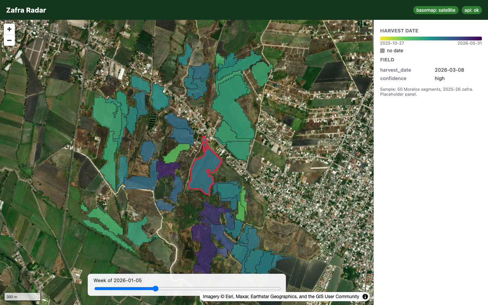

Zafra Radar — application built during NASA Space Apps 2026 (Nov 14–15, Zacatepec). Built on top of zafra-radar-research (https://github.com/JuanToledo23/zafra-radar-research), an open-source toolkit published before the event; see AI_USAGE.md.

# Zafra Radar

Map of the sugarcane harvest (*zafra*) from NISAR L-band radar, for Morelos (Mexico) and
a transfer site in Ribeirão Preto (Brazil). PostGIS 16 + FastAPI + React/MapLibre, started
with one command.

## What existed before the event and what was built during it

| Before the event (in zafra-radar-research, MIT, cited as a resource) | During the event (this repo) |
|---|---|
| NISAR readers (GCOV backscatter, GUNW coherence) | Loader from the library's result files into PostGIS |
| Cane / non-cane gate | API (sites, segment tiles, segment detail, weekly, alerts) |
| Harvest-date detector | Map |
| Validation | Field detail |
| Precomputed result files (harvest maps, weekly counts, series, summaries, raster tiles) | Season dashboard |
| Empty product skeleton (compose, empty schema, `/health`, `/version`, sample map), copied into this repo from `v0.1.0` | Alerts |
| | Raster swipe |
| | Site switcher |
| | Deployment |

Disclosure: the library received one commit during the event, 0d6b064 (2026-11-14), which
adds the comparison of detected harvest with official CONADESUCA mill reports. It is
analysis only and does not touch the skeleton. Everything else in the library is in v0.1.0.

The initial scaffold (empty compose/API/map skeleton) was copied from the product/ directory
of zafra-radar-research v0.1.0 (commit 40edf63, tagged 2026-11-11, before the event). The
copy was taken from the library checkout at commit 0d6b064, where product/ is byte-identical
to v0.1.0.

This repo's git history is the record of the work done during the event;
[docs/JOURNAL.md](docs/JOURNAL.md) is the build log.

## Status

What exists right now is the skeleton as copied from the library:

* `docker compose up` starts PostGIS, the API and the web app;
* the database schema (`api/app/schema.sql`) is created, with empty tables;
* the API answers `/health` (with a database round trip) and `/version` only;
* the map shows a bundled sample of 50 Morelos segments (`web/public/sample.geojson`).

No data is loaded and none of the event features exist yet.

**Planned during the event:** loader, API, map, field detail, season dashboard, alerts,
raster swipe, site switcher, deployment. Build order and estimates:
[HACKATHON_PLAN.md](HACKATHON_PLAN.md).

## Run

```bash
cp .env.example .env          # optional: the database and port defaults are built in
docker compose up --build     # add -d --wait to run in the background until healthy
```

`ZAFRA_DATA` in `.env.example` is for the planned loader (see [DATA.md](DATA.md)); nothing
reads it yet.

| Service | URL / port | Notes |
|---|---|---|
| web | http://localhost:5174 | Vite dev server, hot reload (source bind-mounted) |
| api | http://localhost:8010/health, `/version`, `/docs` | FastAPI, reload on save; also proxied at `/api` from the web app |
| db  | localhost:5434 (user/password/db from `.env`) | PostGIS 16-3.4, named volume `pgdata` |

The compose project is named `zafra-radar-app`, so its containers and volume do not collide
with the library's own skeleton stack (`zafra-radar`). Both use the same host ports, so only
one can run at a time.

```bash
docker compose down           # stop, keep the database volume
docker compose down -v        # stop and delete the database volume
```

The API container applies `api/app/schema.sql` on every start (idempotent `CREATE ... IF NOT
EXISTS`); `docker compose exec api python -m app.seed` reapplies it by hand.

## Offline

The stack needs the network only to **build** (base images, pip, npm). Once built, it
starts and the map renders with no network:

* the basemap (Esri World Imagery) is shown only if a probe tile loads; otherwise, or if
  tiles start failing, the map falls back to a plain background with the sample polygons
  ("basemap: offline (plain)" in the header). The style uses no fonts or sprites;
* to check that no container needs egress at runtime:

  ```bash
  docker compose -f docker-compose.yml -f docker-compose.offline.yml up -d --wait
  ```

  puts db/api/web on an `internal` network (no DNS, no internet). A small TCP forwarder
  (`gateway`) publishes ports 5174 and 8010, because Docker does not publish ports of
  containers on internal networks only.

## Notes

* `postgis/postgis:16-3.4` is published for amd64 only; on Apple Silicon it runs under
  emulation (`platform: linux/amd64` in compose).
* Headless check and screenshot: `cd scripts && npm install && node screenshot.mjs
  [--offline]` writes `docs/skeleton.png` and prints a JSON report (basemap state, API
  state, clicked polygon, console errors). `--offline` aborts every non-localhost request.

## Documentation

* [DATA.md](DATA.md): the input files read from the research library (`ZAFRA_DATA`).
* [docs/RESOURCES.md](docs/RESOURCES.md): data, resources and software used.
* [AI_USAGE.md](AI_USAGE.md): how AI was used, in development and in the product.
* [docs/JOURNAL.md](docs/JOURNAL.md): build log of the event.



## License

Code: MIT ([LICENSE](LICENSE)).
